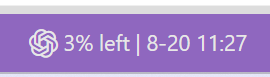

# Agent Center

语言：<a href="https://github.com/mapengsen/Agent-Center/tree/main">English（默认）</a> | <a href="https://github.com/mapengsen/Agent-Center/blob/main/README.zh-CN.md">简体中文</a>

Agent Center 将 Codex / Claude 使用额度、Codex 服务商切换与历史共用、VS Code 联网状态、Clash/Mihomo 节点与订阅管理集中到状态栏，并通过 `code -r` 辅助打开 Codex 对话中的文件链接。支持本地工作区、Remote SSH、WSL 和开发容器。

**GitHub**: [github.com/mapengsen/Agent-Center](https://github.com/mapengsen/Agent-Center)

**Plugin**: [marketplace.visualstudio.com/items?itemName=pengsen.codex-claude-agent-status](https://marketplace.visualstudio.com/items?itemName=pengsen.codex-claude-agent-status)

## 全部功能

| 功能 | 可以做什么 |
| --- | --- |
| Codex 服务商切换与历史共用 | 选择官方 ChatGPT 登录，或直接点选已配置的 `beeapi` 等 API，无需重复输入。保留手动输入 ID 和首次 API 配置入口；切换后全部已索引本地历史对所选服务商可见，切换前备份，失败恢复。 |
| Codex 使用额度 | 查看剩余或已使用百分比、短窗口与长窗口、重置时间，以及账户邮箱和套餐。 |
| Claude 使用额度 | 查看接口返回的 5 小时、7 天、Opus、Sonnet 额度窗口，以及订阅和重置时间。 |
| 额度显示与刷新 | 为两个服务分别选择剩余/已使用模式，用彩色标记查看使用程度；支持点击刷新、定时刷新和失败重试。 |
| VS Code 联网检测 | 从扩展宿主只访问 Google 公开网页；收到任意 HTTP 响应显示 `✅️`，无响应显示 `❌`。图标放在 Clash 地球图标前，启动时检测一次，之后默认每 **5 小时**一次，也可手动检测。 |
| Clash 当前节点与延迟 | 查看 Google 延迟、最终节点、完整选择链和路由模式。自动读取 Clash/Mihomo 控制器配置，识别 Linux/WSL 自定义安装目录；默认每 **5 分钟**测速一次。 |
| 一键切换 Clash 节点 | 在右下角悬浮卡片点击节点，或打开完整节点列表搜索选择；切换后校验选择并重新测速。 |
| 开启与关闭代理 | 在同一悬浮卡片调用原生 Clash 开关，核验控制器启动或停止；关闭后仍保留开启入口，订阅不会被删除。 |
| 更新当前订阅 | 重新下载当前订阅并校验、强制加载到运行中的 Clash，保留仍可用的手动节点选择；失败恢复原配置。关闭时更新后仍保持关闭。 |
| 添加、切换、删除订阅 | 直接粘贴链接自动识别名称，可仅保存或立即切换，显示当前订阅，并可删除任意订阅。删除活动订阅时自动切换到下一个已启用订阅；无可用替代时停止 Clash。需要兼容的 clash-for-linux。 |
| Codex 文件链接补开 | 通过 `code -r` 补开支持的绝对路径链接，默认 **30 种格式**，包含图片、PDF、SVG、Markdown、CSV、TOML 和 Office，可自定义列表；覆盖打开失败与未修改文本标签页，保留未保存修改并防止重复重开。 |
| 远程环境、设置与诊断 | 在当前本地或远程扩展宿主运行，支持功能开关、凭据与代理配置，并查看额度、联网、Clash 和文件补开的诊断结果。 |

## 开始使用

1. 从 [VS Code 插件市场](https://marketplace.visualstudio.com/items?itemName=pengsen.codex-claude-agent-status)安装 **Agent Center**，重新加载窗口。Remote SSH、WSL 或容器窗口需要安装到相应工作区环境。
2. 查看额度时，在同一环境通过 `codex login` 或 `claude /login` 登录。插件读取该环境已有的 CLI 凭据；某个服务没有可用凭据时，会隐藏对应额度项。
3. Google 联网检测无需 Clash 或 API Key。节点显示与切换需要正在运行且控制器可访问的 Clash/Mihomo；订阅管理还需要兼容的 clash-for-linux。
4. 悬停额度项查看详情，点击额度项刷新。悬停或点击 Google/Clash 状态项，在右下角状态栏上方展开原生卡片，操作联网检测、节点和订阅。
5. 点击 **OpenAI 官方 / 服务商 ID** 状态项，或运行 **Agent Center: Switch Codex Provider**。切换功能需要当前扩展宿主安装 **Python 3.8+（含 sqlite3）**，切换后重新加载 VS Code 窗口生效。

| 自动任务 | 默认频率 | 手动入口 |
| --- | --- | --- |
| Codex / Claude 额度 | 启动时刷新，之后每 60 秒再刷新 3 次，再按 **15 分钟**间隔刷新；常规阶段失败每 30 秒重试，单轮最多 5 次。 | 点击对应额度项，或使用刷新命令。 |
| VS Code 扩展宿主 → Google | 启动时检测一次，之后每 **5 小时**一次。 | 悬浮卡片中的“立即检测联网”。 |
| Clash 节点 → Google | 启动时测速，之后每 **5 分钟**一次；切换节点或订阅后也会测速。 | 悬浮卡片中的“刷新测速”。 |

上图展示额度状态项。联网与 Clash 合并显示的示例为 `✅️ 🌐 √ Google（1605 ms）`：最前面的图标表示扩展宿主检测结果，后面的延迟来自独立的 Clash 节点测速。

## Codex 服务商切换与历史共用

点击独立的服务商状态项、Codex 额度悬浮卡片中的“切换服务商”，或运行 **Agent Center: Switch Codex Provider**。没有可用额度凭据时，独立切换入口仍可使用。

- **OpenAI 官方（ChatGPT 登录）**：选择内置 `openai` 和 ChatGPT 认证，保留已有登录文件；尚未登录时，在 Codex 中完成登录。移除用户配置中的自定义 OpenAI / ChatGPT 地址覆盖；扩展宿主存在自定义 `OPENAI_BASE_URL` 时，需要先清除该环境变量。
- **已配置的 API（例如 beeapi）**：自动从当前环境 `config.toml` 的 `[model_providers.*]` 中读取，直接在菜单点击服务商 ID 即可，无需输入任何内容。菜单同时显示配置中的名称并标记当前服务商，重新打开时会读取最新配置；列表只展示 ID 和名称，地址与密钥直接复用。
- **输入其他 API ID…**：保留为备用入口。例如 `model_provider = "beeapi"`，这里只填 `beeapi`，不是模型或显示名称。已有配置直接使用；如果该 ID 尚未配置，会提示填写兼容 Responses API 的 Base URL 和隐藏输入的 API Key，并保存到当前环境的 `config.toml`。密钥不写入 VS Code 设置或诊断日志。要求 ChatGPT 认证的自定义配置需要先改为 API 认证。

**每次明确切换后，当前 `CODEX_HOME` 中全部已索引本地聊天都会共用给所选服务商，再切换仍可使用同一套历史。** 保留聊天正文、JSONL 文件、分页偏移、标题、排序、归档状态和登录文件；归档记录仍在归档列表，工作区和会话类型筛选继续生效。重新加载后，继续聊天使用所选服务商，并受其支持的模型和功能限制。此功能作用于当前环境的本地历史。额度项仍显示已保存 ChatGPT 账户的额度，自定义 API 的余额由其服务商提供。

备份位于 `CODEX_HOME/agent-center/provider-backups/`，默认 `~/.codex/agent-center/provider-backups/`。保留最近 **5 次成功切换的备份**，失败备份保留用于恢复。SQLite 备份包含 WAL 数据；跨窗口锁、配置变更校验和失败恢复保护现有记录。处理只修改历史索引的服务商标记，**不会重写 JSONL 聊天文件**。请先停止正在进行的 Codex 回复，成功后点击 **重新加载窗口** 生效。

当前扩展宿主需要 Python 3.8+ 和标准库 `sqlite3`；默认寻找 `python3`、`python`、Windows `py -3`，也可设置 `agentStatus.codexProvider.pythonPath`。POSIX 配置与备份使用私有权限，Windows 沿用 Codex 目录的访问控制。索引不兼容、已有聊天但缺少历史数据库、启用了配置 profile 或 TOML 格式错误时，会提示修复并停止切换。组织托管配置或自定义 Codex 启动参数中的服务商覆盖仍可能限制实际配置。

## Codex 与 Claude 使用额度

状态栏采用 `5% left | 10-17 11:24` 或 `5% used | 10-17 11:24` 的紧凑格式，两个服务可分别选择剩余或已使用模式。悬停显示百分比与额度窗口的含义、账户或会话、套餐、重置时间、最后更新和操作入口。彩色 Emoji 根据已使用比例从绿、黄、橙变为红。这里的额度是时间窗口中的百分比，不是绝对 Token 数或请求次数。

Codex 优先显示短窗口，短窗口不可用时显示长窗口；Claude 优先显示 5 小时窗口，悬停中显示接口提供的其他 7 天、Opus 和 Sonnet 窗口。重置时间使用插件运行环境的时区，远程服务器与本机时区不同时可能显示不同时间。手动额度刷新显示动画，后台刷新保留当前状态。

Codex 默认读取 `CODEX_HOME/auth.json` 或 `~/.codex/auth.json`，Claude 默认读取 `CLAUDE_CONFIG_DIR/.credentials.json` 或 `~/.claude/.credentials.json`。可用 `agentStatus.codex.credentialsPath`、`agentStatus.claude.credentialsPath` 覆盖路径；各服务还有 `enabled`、`usageDisplayMode`、`usageUpdateIntervalSeconds` 和可选的 HTTP/HTTPS `proxyUrl` 设置。额度功能使用已有登录会话请求服务的额度接口；Google 联网检测独立运行，无需登录。

## Google 网页联网检测

从当前 VS Code 扩展宿主访问 `https://www.google.com/`，在原有 Clash 测速状态项的地球图标前只显示一个联网图标，例如 `✅️ 🌐 √ Google（1605 ms）`：

- `✅️`：收到任意 HTTP 响应，包括 200、跳转、403、429 或 5xx。
- `❌`：未收到 HTTP 响应，包括超时、DNS、连接或证书错误。

启动后立即检测，之后默认每 5 小时检测一次。悬停或点击同一状态项，展开右下角原生卡片，可查看 HTTP 状态、耗时、检测位置和时间，并“立即检测联网”；也可运行 **Agent Center: Test Google Website Connectivity**。不再创建独立的 ChatGPT 状态项，没有 Clash 时只显示联网图标。检测期间保留上次图标，首次收到结果前不显示图标。

新增联网检测只访问 Google 公开网页，不访问 ChatGPT、Claude、额度或聊天 API，不读取登录凭据，无需 API Key。收到响应头后立即停止，不下载页面，不跟随任何跳转。`✅️` 只表示收到 HTTP 响应，不保证页面功能可用。它与通过 Clash 核心进行的节点测速独立，两者可能有不同结果。原有 Codex/Claude 额度功能保留各自的请求和开关。

请求使用 VS Code 扩展宿主提供的 Node HTTP(S) 传输及其代理、证书支持，沿用当前生效的 `http.proxy`、`http.proxySupport` 和环境代理处理。在 Remote SSH / WSL / 容器窗口中检测远程扩展宿主，在普通窗口中检测本机。终端后来设置的环境变量不一定传给已运行的扩展宿主；结果代表 Agent Center 的网页请求，其他扩展以各自实际请求为准。

可通过 `agentStatus.network.enabled` 关闭，`testTimeoutMs` 设置总超时（默认 15000 毫秒），`updateIntervalSeconds` 设置检测间隔（默认 18000 秒，即 5 小时；Clash 节点测速仍默认每 5 分钟一次）。只在受信任工作区检测；关闭功能或卸载时会取消未完成的请求。**Agent Center: Show Diagnostics** 的 `network` 字段提供最近结果，不记录代理密码。

## Clash 节点与 Google 延迟

将 Agent Center 安装到 Remote SSH 的远程环境并重新加载窗口。Linux/WSL 上优先从正在运行的 Clash/Mihomo 进程读取 `-f` 配置路径或 `-d` 数据目录，支持自定义安装位置。也会读取环境变量、PATH 中的 Clash 命令入口及 shell 中登记的 clashctl 路径，最后查找 ~/clash-for-linux/runtime/config.yaml、~/.config/mihomo/config.yaml 等常见位置。自动读取控制器地址和密钥，无需逐台填写安装路径。

- 状态栏显示 **√ Google（3349 ms）**；无法访问、超时或无有效延迟时显示 **× 超时**。
- 悬停显示当前最终节点、完整选择链和路由模式；规则模式显示所选策略组，其他规则可能使用其他组。
- 点击状态栏立即展开右下角状态项上方的原生悬浮卡片，与鼠标悬停时显示相同的节点、测速、订阅和操作入口。点击卡片中的节点可切换，点击“全部节点”可搜索完整列表。切换后校验结果并自动重新测速。
- 使用与 clashtest 一致的 Google 测试地址 https://www.gstatic.com/generate_204，默认超时 8 秒。显示的是连接延迟（ms），不是下载带宽。
- 默认每 5 分钟（300 秒）自动刷新并测速；手动刷新及切换节点或订阅后立即测速。未发现 Clash 时仅显示已启用的独立联网图标；控制器故障显示“Clash 未连接”，可在悬停中重试。

通常将 configPath、installDirectory、controller 和 secret 留空即可。存在多个 Clash 实例、进程信息不可读或控制器位于另一环境时，可在**远程设置**用 agentStatus.clash.configPath 明确选择配置；已有手动设置优先于自动发现。仅填写 installDirectory 时，优先尝试其 `runtime/hosts/<当前主机名>/config.yaml`，再读取 `runtime/config.yaml`。group 留空时根据配置顺序选择手动策略组，全局模式读取 GLOBAL，直连模式读取 DIRECT。多个策略组时可指定 group。testTimeoutMs 和 updateIntervalSeconds 控制测速时限和刷新频率，enabled 可关闭此功能。

发现过程只读取当前扩展宿主的进程参数和命令入口，不执行 shell 启动脚本，不搜索整个磁盘，也不修改 Clash 服务或写回安装路径。服务重启或位置变化后，下次刷新重新识别；订阅目录从发现的运行配置推导。多个实例默认按进程 ID 顺序选择首个可读取的配置，可用手动设置指定目标。

控制器请求在扩展宿主执行，远程窗口的 127.0.0.1 指远程主机。自动识别的 0.0.0.0 监听地址转换为回环地址。节点切换通过 API 完成，控制器自行决定是否保存选择。诊断包含节点和错误，不输出密钥。

命令面板：**Agent Center: Refresh Clash Node Speed**、**Agent Center: Choose Clash Node**、**Agent Center: Show Diagnostics**（查看 clash 字段）。

### 添加、切换与删除订阅（clash-for-linux）

在状态栏悬停菜单点击“添加订阅”“切换订阅”或“删除订阅”。也可在命令面板执行 **Agent Center: Add Clash Subscription**、**Agent Center: Choose Clash Subscription** 或 **Agent Center: Remove Clash Subscription**。

- 切换列表优先显示订阅服务提供的名称（响应头 `profile-title` 或下载文件名），无法读取时显示来源域名。下方同时显示原订阅标识和来源域名，以便区分同名订阅。打开订阅列表或添加链接时读取名称，收到响应头后停止读取，不应用配置；名称在内存缓存一小时，失败缓存五分钟，日常测速复用缓存。
- 添加时只需粘贴 HTTP/HTTPS Clash YAML 链接，自动识别订阅名称；读取不到时使用来源域名。名称自动处理不兼容字符，重名时追加 `-2` 等后缀，再选择“保存订阅，保留当前连接”或“保存并立即切换”。仅保存时不会下载或替换当前配置。
- 切换会调用远程 clash-for-linux 的原生 `use` 命令，下载、生成配置并按其服务管理方式重启 Clash；期间代理连接可能短暂中断。失败时尝试恢复原订阅和手动节点选择，并明确报告恢复结果。
- 所有订阅（包括 `default`）均可确认删除。删除当前订阅时，先按列表顺序切换到下一个已启用的订阅，末尾回到开头；切换失败时保留原订阅。删除非当前订阅时保留当前连接。没有已启用的备用订阅时，先停止 Clash，再删除；删除最后一个订阅后列表清空，重新添加并切换订阅可再次启动。插件通过安装中的配置写入器和 `yq` 管理存储，适配原生脚本的 `default` 限制，无需修改 clash-for-linux 源码。
- 链接输入框隐藏内容；订阅保存在原生运行目录的 `subscriptions.yaml` 中，不写入插件源码、VS Code 设置或插件日志。插件通过标准输入将链接交给原生订阅写入器；后续下载由 clash-for-linux 管理。订阅持久保存；请保护服务器中的订阅文件。
- 需要在 Linux/WSL 的扩展宿主安装兼容的 clash-for-linux（包含 `scripts/core/clashctl.sh`、`common.sh`、`config.sh`、`runtime/bin/yq` 和订阅文件）。自动从 `runtime/config.yaml` 或集群的 `runtime/hosts/<主机名>/config.yaml` 推断安装目录，订阅读取、锁和失败恢复均使用对应运行目录；执行原生命令前核对目录，拒绝操作其他主机的运行目录。自动发现不可用时，可用 `agentStatus.clash.installDirectory` 指定安装根目录。只有 Clash 控制器 API 的安装不支持此订阅管理功能。

悬停会显示当前订阅的已缓存名称（或来源域名）和原标识，选择节点与切换订阅使用独立入口。

### 开启代理、关闭代理与更新当前订阅

在同一右下角悬浮卡片点击“开启代理”“关闭代理”“更新当前订阅”，或运行下方对应命令。

- 开启和关闭调用 [wnlen/clash-for-linux](https://github.com/wnlen/clash-for-linux) 的原生 `clash on` / `clash off`，并核验控制器状态；关闭后显示“Clash 已关闭”，仍可点击开启。
- 更新调用 `clash sub update`，使用已保存的当前链接，不添加新订阅、不切换到其他来源。“刷新测速”仍只测速，不下载订阅。
- 运行中更新会强制加载生成的配置，再核对实际节点与策略组，保留更新后仍存在的手动节点选择。失败会尝试恢复原配置、订阅和运行状态，并明确提示恢复结果。代理关闭时更新后仍保持关闭。
- 支持普通目录和按主机隔离的运行目录。旧版 `scripts/cmd/clashctl.sh` 安装也支持这三个操作，使用其原生 `clashon` / `clashoff` / `clashsub update`；旧版关闭后仍能从 Shell 注册入口重新识别配置。
- 开关在当前扩展宿主所在的 Linux/WSL 环境执行。原生脚本管理服务和持久代理状态；已有终端及已启动的 VS Code 进程环境变量不会被子进程直接改写，必要时重新打开终端或重新连接远程窗口。前方 Google 联网图标继续按其独立检测周期更新。

## 打开 Codex 对话中的文件

更新 Agent Center 并重新加载 VS Code 窗口后，直接点击 Codex 对话中原有的文件绝对路径链接。如果 Codex 记录了受支持的打开失败日志，Agent Center 会执行 `code -r` 打开该路径。无需专用链接，也无需修改 Codex。默认支持以下 30 种扩展名：

| 类别 | 扩展名 |
| --- | --- |
| 图片、PDF | `.png`、`.jpg`、`.jpeg`、`.gif`、`.webp`、`.bmp`、`.ico`、`.pdf`、`.svg` |
| Markdown、文档 | `.md`、`.markdown`、`.mdx`、`.rst` |
| 表格数据 | `.csv`、`.tsv` |
| 网页 | `.html`、`.htm` |
| Notebook | `.ipynb` |
| 科研文档 | `.tex`、`.bib` |
| 配置与日志 | `.log`、`.json`、`.jsonl`、`.yaml`、`.yml`、`.toml`、`.xml` |
| Office 文档 | `.docx`、`.xlsx`、`.pptx` |

打开效果与手动执行 `code -r` 一致，由默认编辑器决定。PDF、Office 预览需要相应的查看器扩展；Markdown、CSV 和 HTML 不会被强制切换为渲染预览、表格或浏览器。

支持的文件也可能被 Codex 成功打开为纯文本，因此没有失败日志。Agent Center 会检测这种活动文本标签页，先关闭该文件未修改的文本标签页，再执行 `code -r`。这样 CLI 可以选择默认编辑器，而不是继续复用文本标签页。已有的预览、Notebook、差异对比及未保存修改会保留。监听启动时也会检查当前活动文本标签页。

VS Code 没有提供文本标签页的打开来源，因此这项检测适用于所有来源，不限 Codex。需要保留原有文本标签页时，可关闭 `agentStatus.codexImageLinks.reopenTextDocuments`，或从扩展名列表中移除特定格式。如果默认编辑器仍返回文本标签页，监听器会保留它供正常编辑，并防止重复重开，包括 CLI 启动较慢的情况。

Agent Center 在后台启动当前 VS Code 安装自带的命令行工具，将路径作为独立参数传入，不会向你的终端输入命令。远程会话沿用当前扩展宿主的 CLI 连接。Windows 上直接运行 `code.cmd` 对应的 CLI 入口，保留路径中的空格、中文和特殊字符。执行失败可在 Show Diagnostics 中查看。

使用 Remote SSH、WSL 或开发容器时，将 Agent Center 安装到 Codex 处理该文件的工作区环境中。两个扩展必须位于同一窗口、同一扩展宿主；此功能不会将远程路径转换为 Windows 本地路径。如果安装过单独的实验扩展 **Codex Image Opener**，请先禁用或卸载它，以免重复处理。

失败日志补开根据 Codex `26.917.62051` 中检查到的格式实现，并非 Codex 公开的点击事件接口；Codex 后续更改日志格式时可能需要适配。文本标签页补开独立使用 VS Code 编辑器事件，不依赖失败日志。网页 URL 和虚拟文档不处理。自动测试使用模拟 VS Code API 验证两条补开流程，并覆盖 CLI 定位和真实子进程的路径参数传递；远程 VS Code 会话中的真实点击尚未验证。

Agent Center 只读取当前窗口原有 `Codex.log` 的新增内容，启动时跳过历史记录，仅在窗口获得焦点且工作区受信任时打开文件。它不会复制、移动或写入该日志。补开诊断只在内存中保留最近 40 条，原始日志仍由 VS Code 管理。

- `agentStatus.codexImageLinks.enabled`：启用或关闭自动补开，默认 `true`。
- `agentStatus.codexImageLinks.extensions`：替换默认扩展名列表，同时控制日志与文本标签页两条补开流程。不区分大小写，可省略开头的点，归一化后去重；空列表表示不处理任何格式。
- `agentStatus.codexImageLinks.reopenTextDocuments`：补开配置列表内、任何来源的未修改文本标签页，默认 `true`；需要保留原有文本标签页时可关闭。
- **Agent Center: Show Diagnostics**：查看 `codexImageLinks.status`、`extensions`、`textEditorRecovery`、日志路径和最近结果；每条结果标明 `codex-log` 或 `text-editor` 来源。`watching` 表示已找到日志；`waiting for Codex.log` 表示预期位置尚未出现日志。等待日志时，编辑器事件补开仍可运行。
- **Agent Center: Restart Codex File Link Listener**：排查问题后重启监听，然后重新点击文件链接。
- `agentStatus.codexImageLinks.logFile`：高级设置，手动指定当前窗口、当前扩展宿主中的 `Codex.log` 绝对路径；留空自动定位。它指定读取来源，不会在该路径创建新日志。

## 全部命令

按 `Ctrl+Shift+P` / `Cmd+Shift+P` 打开命令面板，搜索 **Agent Center**。插件提供的全部命令如下：

| 命令 | 用途 |
| --- | --- |
| Agent Center: Switch Codex Provider | 选择官方 ChatGPT 或输入 API 服务商 ID，将全部已索引本地历史共用给所选服务商。 |
| Agent Center: Refresh Codex Usage | 立即刷新当前环境的 Codex 额度。 |
| Agent Center: Choose Codex Usage Display | 选择 Codex 显示剩余或已使用百分比。 |
| Agent Center: Refresh Claude Usage | 立即刷新当前环境的 Claude 额度。 |
| Agent Center: Choose Claude Usage Display | 选择 Claude 显示剩余或已使用百分比。 |
| Agent Center: Test Google Website Connectivity | 立即运行扩展宿主的 Google 联网检测。 |
| Agent Center: Refresh Clash Node Speed | 刷新 Clash 状态并检测当前选择节点的 Google 延迟。 |
| Agent Center: Start Clash Proxy | 开启当前环境的 Clash 代理并核验配置加载。 |
| Agent Center: Stop Clash Proxy | 关闭 Clash 代理并确认控制器停止，保留订阅。 |
| Agent Center: Update Current Clash Subscription | 重新下载并更新当前订阅，保留原开关状态，失败恢复。 |
| Agent Center: Choose Clash Node | 搜索并切换手动策略组中的节点。 |
| Agent Center: Add Clash Subscription | 粘贴链接识别名称，再选择保存或立即切换。 |
| Agent Center: Choose Clash Subscription | 选择并应用已保存订阅。 |
| Agent Center: Remove Clash Subscription | 确认删除订阅，必要时自动切换或停止 Clash。 |
| Agent Center: Restart Codex File Link Listener | 重启日志定位与文本标签页补开监听。 |
| Agent Center: Show Diagnostics | 在 Agent Center 输出面板查看全部功能的诊断结果。 |
| Agent Center: Open Settings | 打开插件设置。 |

## 功能设置与诊断

在设置中搜索 **Agent Center**，或运行 **Agent Center: Open Settings**。各项功能均默认启用，可独立关闭：

| 设置分组 | 启用/关闭 | 其他选项 |
| --- | --- | --- |
| Codex 服务商切换 | `agentStatus.codexProvider.enabled` | `pythonPath` |
| Codex 额度 | `agentStatus.codex.enabled` | `credentialsPath`、`usageDisplayMode`、`usageUpdateIntervalSeconds`、`proxyUrl` |
| Claude 额度 | `agentStatus.claude.enabled` | `credentialsPath`、`usageDisplayMode`、`usageUpdateIntervalSeconds`、`proxyUrl` |
| 扩展宿主 Google 联网检测 | `agentStatus.network.enabled` | `testTimeoutMs`、`updateIntervalSeconds` |
| Clash 节点与订阅 | `agentStatus.clash.enabled` | `configPath`、`controller`、`secret`、`installDirectory`、`group`、`testTimeoutMs`、`updateIntervalSeconds` |
| Codex 文件链接补开 | `agentStatus.codexImageLinks.enabled` | `extensions`、`reopenTextDocuments`、`logFile` |

最后一列的选项使用本行对应的设置前缀，例如 `agentStatus.network.updateIntervalSeconds`。Remote SSH、WSL 和容器中使用对应远程环境的设置与文件路径。未显式填写 Agent Center 额度设置时，会兼容读取已有的 Notifyer 旧版额度设置。

**Agent Center: Show Diagnostics** 会在输出面板显示 `codex`、`codexProvider`、`claude`、`network`、`clash` 和 `codexImageLinks`，用于查看当前服务商、处理的历史数量、备份位置及已有监控结果。输出不包含访问令牌、API Key、代理密码、控制器密钥或完整私密订阅链接。服务商切换、文件补开、联网检测和 Clash 操作需要受信任工作区。

## 相关插件

[Notifyer](https://marketplace.visualstudio.com/items?itemName=pengsen.codex-task-companion) 是同一发布者的另一个扩展。

## 更新日志

各版本完整变更见[完整更新日志](CHANGELOG.md)。

### 0.1.26 - 2026-10-21

- 服务商菜单自动列出已配置的 API，展示 ID、名称和当前选择，直接点击即可切换，无需重复输入 ID、网址或密钥。

### 0.1.25 - 2026-10-21

- 新增 Codex 服务商切换、首次 API 配置、全部本地历史共用、备份与失败恢复；GitHub 和插件市场补齐完整功能说明。

### 0.1.24 - 2026-10-21

- 原生悬浮卡片新增开启/关闭 Clash 和更新当前订阅，核验运行配置并支持失败恢复。

### 0.1.23 - 2026-10-19

- 支持自定义安装路径和按主机隔离的 clash-for-linux 运行目录。

### 0.1.22 - 2026-10-17

- 在 GitHub 和插件市场的中英文主页补齐全部功能、使用方式、刷新频率、设置及所有命令。

### 0.1.21 - 2026-10-17

- 扩展宿主的 Google 联网检测改为默认每 5 小时一次；Clash 节点测速仍默认每 5 分钟一次。

### 0.1.20 - 2026-10-17

- 在 Clash 地球图标前以单个 `✅️` / `❌` 显示 Google 联网结果，收到任意 HTTP 响应即视为连通。

### 0.1.10 - 2026-10-15

- 新增 clash-for-linux 订阅添加、保存或立即切换、当前订阅显示，以及切换失败后的恢复处理。

### 0.1.9 - 2026-10-15

- 新增 Clash/Mihomo Google 延迟、当前节点悬停提示和一键切换，支持自动读取远程配置。

### 0.1.8 - 2026-09-30

- 从默认 `code -r` 补开格式中移除 `.txt`，其他已配置格式保持不变。

### 0.1.7 - 2026-09-29

- 将 `code -r` 补开范围扩展到 31 种格式，新增 Markdown、CSV/TSV、HTML、Notebook、LaTeX/BibTeX、普通文本与配置（含 TOML），以及 Office 文档。
- 新增两条补开流程共用的扩展名配置列表，兼容原生 Notebook 编辑器，并防止 CLI 启动较慢时重复重开文本标签页。

### 0.1.6 - 2026-09-29

- 修复 PDF/SVG 被 Codex 当作文本成功打开、没有失败日志时无法补开的问题：先关闭未修改的文本标签页，再执行 `code -r`。
- 新增独立的文本标签页补开开关、未保存修改保护、防重复重开，以及诊断事件来源标记。

### 0.1.5 - 2026-09-29

- 补开方式改为通过 VS Code 自带 CLI 执行 `code -r`，支持远程窗口连接信息传递及进程执行时限。
- 新增 PDF、SVG 链接支持，以及 CLI 执行失败诊断。

### 0.1.4 - 2026-09-29

- 新增 Codex 图片绝对路径链接自动补开功能，支持诊断查看和开关设置。
- 增量读取日志并限制读取量，支持日志轮转与重复事件去重；补开诊断仅保存在内存中。

### 0.1.3 - 2026-08-24

- 将悬浮提示中的单色 Codicon 替换为一套独立的彩色 Emoji。
- 根据已使用额度增加绿、黄、橙、红动态百分比标记。

### 0.1.2 - 2026-08-24

- 将插件展示品牌改为 Agent Center，同时保留原有 Marketplace 扩展 ID。
- 为 Codex 和 Claude 悬浮详情的各信息段落增加 Codicon 图标。
- 源代码仓库迁移到 `mapengsen/Agent-Center`。

### 0.1.1 - 2026-08-20

- 优化启动刷新、常规刷新与失败重试调度。
- 仅在手动刷新期间显示旋转刷新动画。

### 0.1.0 - 2026-08-19

- 从 Notifyer 中拆分并首次独立发布。
- Codex/Claude 凭据读取、网络请求、状态栏、悬浮说明、刷新动画和定时刷新现在全部在当前工作区环境内运行。
